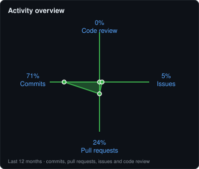

<!-- Dark "hub" style overview, modelled on a dashboard layout: banner, stat row, contributions, tech stack, notable projects -->

---

## 👤 About

Pre-final-year **B.Tech CSE (Data Science)** student at **VIT Vellore** (2024–2028), aspiring software engineer seeking **software development, AI and data science internships**. I build practical AI-powered tools in **Python** and **C**, and I'm an **AI and DSA enthusiast**. *Designing solutions, building the future.*

`Focus` · **LLMs & RAG** · **Computer Vision** · **Data Structures & Algorithms** · **Scalable solutions**

---

## 📊 Stats

---

## 🎯 Activity overview

---

## 🧰 Tech stack & languages

<table>
<tr>
<td valign="top" width="55%">

**Core technologies**

</td>
<td valign="top" width="45%">

</td>
</tr>
</table>

---

## 📌 Notable projects

<table>
<tr>
<td></td>
<td></td>
</tr>
<tr>
<td></td>
<td></td>
</tr>
</table>

**Featured projects**

| Project | What it does | Stack |
|---|---|---|
| [**AI-PDF-Chatbot**](https://github.com/DibbankurDey) | AI-powered PDF chatbot: upload documents and ask questions, answered with retrieval-augmented generation | Python, LLMs, RAG |
| [**Self Navigation Vision System**](https://github.com/DibbankurDey/Self-Navigation-Vision-System) | Real-time vision-based navigation assistant with object detection and a Streamlit interface | Python, Streamlit |
| **AutoML Intelligence System** | Automates the ML workflow: data in, trained and evaluated models out | Python, scikit-learn |
| **OsTutor** | Fine-tuned chatbot that tutors Operating Systems concepts | Python, LLM fine-tuning |
| **CircuitDSL** | DSL for digital logic circuits with semantic error detection | Compiler design |

*More repos are being added as they go public.*

## 🎖️ Certifications

- **Oracle Certified Professional, Java Programmer** (Java Foundations Associate), Oracle, Jul 2026
- **Data Analytics Job Simulation**

Full list on [LinkedIn](https://linkedin.com/in/dibbankur-dey-577a5631b).

---

